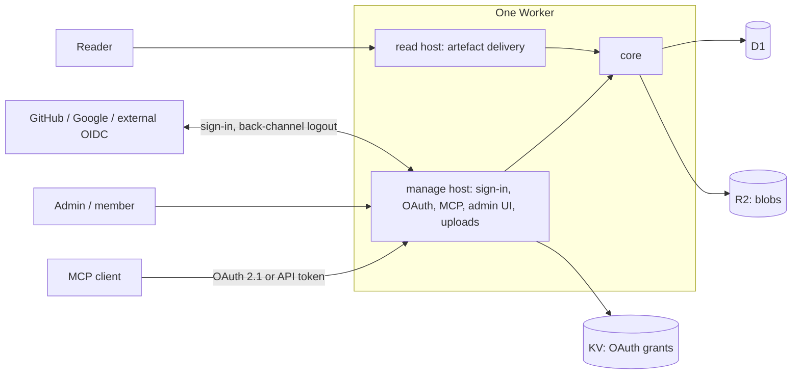

# unkill-forge — Specification (Forge v2)

Status: draft for owner approval · 2026-11-22 · Repository: `go-silex/unkill-forge` (public, MIT, fresh history).

This document is public-safe: it describes the product only. Instance data, hostnames and migrations from other systems live in private operator material, never in this repository.

## 1. Purpose

Forge lets a team publish HTML artefacts (one page or a small static folder) at stable URLs, decide who can read them, and create, read and edit them from AI agents through a remote MCP server.

Design target: one person can read the whole codebase in an afternoon and deploy it to their own Cloudflare account in under an hour.

## 2. Goals and non-goals

| #   | Goal                                                                                                                                                                                                                                            |
| --- | ----------------------------------------------------------------------------------------------------------------------------------------------------------------------------------------------------------------------------------------------- |
| G1  | Publish, update and read back artefacts from claude.ai, Claude Desktop, Claude Code, Codex, autonomous agents such as Hermes, or any MCP client, with no local plugin.                                                                          |
| G2  | Three ways to read: members (private), anyone holding a revocable share link, everyone (public).                                                                                                                                                |
| G3  | Sign-in through GitHub, Google, or an external identity manager over OIDC (an in-house identity provider, Cloudflare Access, Keycloak, Entra…). Deactivation at the identity manager reaches Forge. Instance roles; bot members for automation. |
| G4  | Forkable: Cloudflare only (Workers, D1, R2, KV); branding through configuration and assets, not code edits.                                                                                                                                     |
| G5  | Small: a runtime budget around 7,000 lines of TypeScript, tracked, not a release gate; at most four guides besides README (see §17).                                                                                                            |
| G6  | Safe defaults: new artefacts are private; untrusted HTML runs on its own origin; every authorization decision reads live state.                                                                                                                 |

Non-goals:

- Multi-tenant SaaS. One deployment serves one team.
- Access control per page inside an artefact; assets shared across artefacts.
- HTML or CSS rewriting; revision-pinned reads.
- Built-in URL shorteners.
- A local plugin, native binaries, a CLI or an HTTP API. MCP is the programmatic interface (see §17).
- Browser upload in the admin UI.
- Trusted-proxy identity headers (`Cf-Access-Jwt-Assertion`, forward-auth): external managers connect over OIDC.
- Linking several sign-in identities to one member.
- Isolation between artefacts of the same instance (see §13).
- Importers for other systems.

## 3. Vocabulary

| Term                  | Meaning                                                                                               |
| --------------------- | ----------------------------------------------------------------------------------------------------- |
| **Instance**          | One deployment: its two hostnames, members, artefacts and storage.                                    |
| **Artefact**          | A named folder of files served under `/a/<slug>/`. The unit of access.                                |
| **Slug**              | The artefact's address name.                                                                          |
| **Revision**          | An immutable, numbered snapshot of an artefact's file list. Publishing creates the next number.       |
| **File**              | A path inside a revision, pointing to a blob, with size and content type.                             |
| **Blob**              | Content-addressed bytes in R2, keyed by SHA-256, shared by every file with the same content.          |
| **Visibility**        | `private` (members) or `public` (everyone).                                                           |
| **Share link**        | A secret URL `/s/<slug>/<key>/` that lets anyone read one artefact until the link is revoked.         |
| **Identity provider** | A configured sign-in source: `github`, or an `oidc` provider (Google, an external identity manager).  |
| **Identity**          | One (provider, subject) pair that has signed in. It belongs to one member.                            |
| **Member**            | A human (one identity) or a bot (created by an admin), with a role: `viewer`, `publisher` or `admin`. |
| **API token**         | A bearer secret belonging to one member, used by bots and scripts on the MCP endpoint.                |
| **Invite link**       | A single-use URL that makes the person who signs in through it a member with a given role.            |

## 4. Architecture



- **One Worker, two hostnames.** The read host serves untrusted artefact HTML; the manage host carries sessions, OAuth and administration. The Worker first matches the request against the two configured HTTPS origins and answers 404 to anything else, before any authentication, routing or asset lookup. `workers_dev` and preview URLs are disabled. The hosts apply separate access policies even when a path exists on both.
- **Core owns policy.** `src/core/` alone owns Forge's tables and R2, and alone decides access, roles and session validity. Adapters (delivery, MCP, admin UI, sign-in, OAuth glue) verify credentials, call core and render results; they make no authorization decision of their own.

| Concern           | Choice                                                                               | Why                                                                                                                                                                                                                         |
| ----------------- | ------------------------------------------------------------------------------------ | --------------------------------------------------------------------------------------------------------------------------------------------------------------------------------------------------------------------------- |
| HTTP              | Hono                                                                                 | Small, Workers-native, JSX for server-rendered pages.                                                                                                                                                                       |
| Sign-in           | Forge login module on `oauth4webapi` + `jose` (panva)                                | One code path for every OIDC provider (Google included) plus a small GitHub adapter; Forge owns sessions, claim rules, silent revalidation and back-channel logout, which generic auth frameworks leave to the application. |
| MCP authorization | `@cloudflare/workers-oauth-provider` (KV)                                            | Workers-native OAuth 2.1 server: PKCE, CIMD, optional DCR, and a token-resolution hook for API tokens. Gate 0 confirms it.                                                                                                  |
| MCP protocol      | `@modelcontextprotocol/sdk`, Web-standard Streamable HTTP, stateless, JSON responses | No sessions, no Durable Objects.                                                                                                                                                                                            |
| Validation        | zod                                                                                  | One schema per tool and form.                                                                                                                                                                                               |
| Database          | D1, plain SQL migrations (`wrangler d1 migrations`)                                  | Readable by forkers; no ORM.                                                                                                                                                                                                |
| Tests             | Vitest + `@cloudflare/vitest-pool-workers` (real D1/R2 in workerd)                   | Behaviour tests.                                                                                                                                                                                                            |
| Tooling           | npm + TypeScript                                                                     | No Bun, Turborepo or monorepo.                                                                                                                                                                                              |

Repository layout:

```
src/
  index.ts        origin dispatch, cron entry
  core/           artefacts, revisions, blobs, access, shares, members, sessions, tokens, uploads, redirects, audit
  read/           delivery, login handoff
  manage/         ui/ (Hono JSX), mcp/ (tools), oauth/ (consent, provider glue), login/ (oidc, github, back-channel), upload.ts
  config.ts       parse and validate configuration once
migrations/
brand/            default logo, favicon, colours
test/
docs/             self-hosting.md, mcp.md, architecture.md, security.md
wrangler.jsonc    template without account identifiers
```

**Decision: standalone, not a kit product.** Starting from `unkillable-kit` would hand every fork a full monorepo (Bun/Turbo, 15 packages, multi-tenant schema, kit governance). Forge uses upstream libraries directly. It takes the kit's MCP OAuth decisions as reference (CIMD first, consent on a dedicated origin, Worker-issued tokens), not its code.

## 5. Data model

| Table                  | Columns (essentials)                                                                                                                                                                           |
| ---------------------- | ---------------------------------------------------------------------------------------------------------------------------------------------------------------------------------------------- |
| `members`              | `id` PK, `kind` ∈ human/bot, `name`, `email`, `role` ∈ viewer/publisher/admin, `status` ∈ pending/active/removed, `created_at`, `created_by`, `removed_at`, `generation` (advanced on removal) |
| `identities`           | (`provider`, `subject`) PK, `member_id` UNIQUE, `email`, `email_verified`, `last_login_at`                                                                                                     |
| `login_flows`          | `state_hash` PK, `browser_hash`, `provider`, `return_path`, `session_hash` for revalidation, `created_at`, `expires_at`                                                                        |
| `login_flow_metadata`  | `state_hash` PK and FK, `generation` (removal watermark), `invite_hash`, `retry_login_hint` (silent OIDC flows only)                                                                           |
| `invite_contexts`      | `id` PK, `browser_hash`, `invite_hash` FK, `expires_at`                                                                                                                                        |
| `sessions`             | `id_hash` PK, `member_id`, `provider`, `subject`, `sid`, `auth_time`, `created_at`, `validated_at`, `expires_at`, `revoked_at`, `generation`                                                   |
| `identity_revocations` | (`provider`, `jti`) PK, `subject` NULL for sid-only events, `sid` NULL for subject-wide events, `received_at`                                                                                  |
| `oauth_consents`       | `token_hash` PK, `session_hash`, validated authorization request URL, `expires_at`                                                                                                             |
| `invites`              | `token_hash` PK, `role`, `created_by`, `created_at`, `expires_at`, `used_by`, `used_at`                                                                                                        |
| `artefacts`            | `id` PK, `slug` UNIQUE, `title`, `visibility` ∈ private/public, `current_revision`, `created_by`, `created_at`, `updated_at`, `deleted_at`                                                     |
| `revisions`            | (`artefact_id`, `number`) PK, `created_by`, `created_at`, `message`, nullable `entry_path` for legacy revisions                                                                                |
| `files`                | (`artefact_id`, `revision`, `path`) PK, `sha256`, `size`, `content_type`                                                                                                                       |
| `share_links`          | `id` PK, `artefact_id`, `label`, `key_hash` UNIQUE, `key_sealed`, `created_by`, `created_at`, `revoked_at`, `last_used_at`                                                                     |
| `api_tokens`           | `id` PK, `member_id`, `name`, `prefix`, `token_hash` UNIQUE, `created_at`, `last_used_at`, `revoked_at`                                                                                        |
| `uploads`              | `token_hash` PK, `upload_id` UNIQUE, `member_id`, `member_generation`, `slug`, `path`, `sha256`, `size`, `content_type`, `state`, `expires_at`, `created_at`                                   |
| `handoffs`             | `code_hash` PK, `session_id_hash`, `state_hash`, `return_path`, `expires_at`                                                                                                                   |
| `redirects`            | `from_prefix` PK, `source_slug`, `target_artefact_id` FK, `target_path` (encoded suffix), `created_at`, `created_by`                                                                           |
| `audit_log`            | `id`, `at`, `member_id`, `action`, `artefact_id`, `detail_json`                                                                                                                                |

Indexes:

- `artefacts(deleted_at, updated_at)`, `share_links(artefact_id)` plus an active-only index, `files(sha256)`;
- `sessions(member_id)`, `sessions(provider, subject)`, `sessions(provider, sid)`, `identity_revocations(provider, subject)`;
- `api_tokens(member_id)`, `audit_log(artefact_id, at)`;
- `expires_at` on `login_flows`, `invites`, `uploads`, `handoffs`.
- `redirects(from_prefix)` for exact probes of the URL's slash-delimited prefixes, `redirects(source_slug)` for slug reservations, `redirects(target_artefact_id)` for cascading removal;
- `uploads(sha256, expires_at)` for stored-upload references to blobs.

`generated_covers` stores one row per artefact: the exact revision, retry and lease state, and an optional bounded JPEG. These are derived catalogue data, not revision files.

`artefact_purges` reserves a slug and tracks the purge by stable artefact ID; `purge_candidates` holds its candidate hashes. `blob_purge_claims` holds the exclusive delete claim per hash, `blob_purge_epoch` advances when claims start or finish, and `purge_attempts` leases R2 deletion per artefact.

Rules:

- Blobs live at `blobs/<sha256>` in R2, written with R2's SHA-256 check and never overwritten. A new revision reuses existing blobs for unchanged files: no byte copy.
- Slug: `^[a-z0-9](?:[a-z0-9-]{0,62}[a-z0-9])?$`. A slug is unavailable while a live artefact, a soft-deleted artefact, a redirect prefix or an unfinished purge uses it.
- Path: relative POSIX path, ≤ 512 characters, no empty, `.` or `..` segment, no segment starting with `.`, no backslash or control character.
- Retention: the last 20 revisions per artefact by default (configurable), so `files` stays bounded within D1's size limits.
- Defaults (configurable): 1,000 files per artefact; 500 distinct new blob writes per publish; 2 MiB of decoded inline content per MCP call; 100 MB per uploaded file. Inline content is capped at 8 MiB; larger files must use uploads. The blob-write limit leaves room within the Workers subrequest budget and does not count hashes already referenced in D1. Split updates with more new blobs into several `merge` publishes.

## 6. Access model

**Canonical reads** (`/a/…`), decided by core:

1. Artefact missing or deleted → not found.
2. `public` → allowed.
3. Viewer holds a valid session (§10) of an **active** member → allowed.
4. Otherwise → anonymous: login handoff; signed-in non-member: "pending access" page.

**Share-link reads** (`/s/…`) use one rule only: the key matches an unrevoked share link of that artefact, whatever its visibility. A revoked key returns 404 even on a public artefact.

| Action                                                                        | viewer | publisher | admin |
| ----------------------------------------------------------------------------- | :----: | :-------: | :---: |
| Read private artefacts                                                        |   ✓    |     ✓     |   ✓   |
| Create, publish, edit, rename, delete, restore; visibility; share links       |        |     ✓     |   ✓   |
| Own API tokens                                                                |        |     ✓     |   ✓   |
| Members, bots, invite links, redirects, purge; supply a share key at creation |        |           |   ✓   |

- Publishers may change any artefact: a team trusts its publishers.
- Every request loads the member's live status and role from D1; tokens and cookies never carry a role. Removing a member ends read, UI and MCP access on their next request, OAuth refresh included.

## 7. Read host

Resolution order for a request:

1. `/a/<slug>` → 301 to `/a/<slug>/`.
2. `/a/<slug>/<path>` where `slug` is a live artefact → apply canonical access, then resolve `path`, `path/index.html`, `path.html` in the current revision. A denied reader gets the access response whether or not the file exists. If the directory index wins and the path has no trailing slash, return 301 to the slash form with the query string preserved.
3. `/s/<slug>/<key>` and `/s/<slug>/<key>/<path>` → check that the key belongs to an active link of a live artefact. After the check, redirect the bare URL to its trailing slash with 301, or apply the same path resolution as `/a/`, including the directory-index redirect. The stable root `/s/<slug>/<key>/` serves the root `index.html` if present; otherwise it temporarily redirects (302) to the current revision's entry file within the share prefix. Redirects preserve the query string. Relative subresources stay under the share prefix without a cookie. Successful file resolutions trigger a best-effort `last_used_at` update at most once per minute per link.
4. `POST /_forge/session` → end of the login handoff.
5. Otherwise, for a missing canonical or share slug, the longest matching `redirects.from_prefix` → 302 to the target with the remaining encoded path and query string appended. Redirects never shadow a live or soft-deleted slug. A deleted target returns the standard 404 without trying shorter prefixes. A private canonical target requires the normal canonical access check before the 302; login returns to the original alias. A share alias requires an active key of the target artefact before disclosing its slug; other keys receive the standard 404. All alias responses use `private, no-store` and no `ETag`.
6. `/` → show a sign-in action that opens the Manage catalogue and, when `PUBLIC_INDEX=true`, the newest 200 public artefacts by creation time. `?view=list` shows them as a compact list instead of the default grid; any other value keeps the grid. The Manage catalogue offers the same choice, shows its list as a table, and keeps the choice across search and pagination.
7. `GET` or `HEAD /_forge/preview/<slug>` → with `PUBLIC_INDEX=true`, serve the current cover of a live public artefact. The manage host instead requires an active, fresh browser session and a same-origin image request.
8. Anything else → 404.

The public gallery and the paginated Manage catalogue use cover files published at the root of the current revision: `og.jpg`, `og.jpeg`, `og.png`, `og.webp` or `index.og.png` in that order. Files must be at most 1 MiB and match the expected raster media type and signature. An artefact with no cover is still listed. Preview requests do not fall back to other paths, revisions, aliases or shares.

Supplying a cover is optional. When cover generation is enabled, a background pass captures the entry of an HTML revision without a valid supplied cover, including already-published artefacts. Forge uses the generated JPEG only for that exact live head. This does not change the revision, its files, visibility or share links.

Unknown artefacts, unauthorized share requests and missing files return the same 404, but a missing file in a private artefact only returns 404 to a reader with access. Other readers get the handoff or pending response regardless of whether the file exists.

Response headers:

- All responses: `X-Content-Type-Options: nosniff`; `Referrer-Policy: same-origin`.
- `X-Robots-Tag: noindex`, unless canonical content is public and indexing is enabled. Share URLs always send `noindex`.
- Caching: `/s/` and non-public content send `Cache-Control: private, no-store`, without an `ETag`. Public canonical content sends `no-cache` and a strong `ETag` combining the blob SHA-256 and the first eight hex digits of the served content type's SHA-256. Every request, including a `304`, goes through the access check. A type change invalidates the cache even when the bytes are unchanged.
- Range requests are served from R2.

**Login handoff.** Sessions live on the manage host; the read host keeps its own cookie, bound to that session.

1. A top-level navigation to a private artefact without a read session sets or refreshes the ten-minute `__Host-forge-state` browser cookie (HttpOnly, Secure, SameSite=None). It redirects to `/auth/handoff` on the manage host with the return path, a per-flow nonce and a challenge derived from the browser cookie and nonce. The return URL has a limit of 8,192 characters measured after URL encoding; if the path and query exceed it, the handoff keeps the path and drops the query. The read host then wraps that path and query in unpadded base64url so it does not expand when nested inside the manage sign-in URL. Unauthenticated subresources return an empty, non-cacheable 401 without starting a handoff. If Fetch Metadata is missing, a GET accepting `text/html` is treated as a navigation unless the available metadata indicates otherwise.
2. The manage host requires a valid session (signing in if needed). It decodes the base64url value, validates it as a read-host path starting with `/a/` (decoded, normalised, no scheme or empty segments), and enforces the same return URL limit. It stores a single-use code (60 s) with the session and the state hash, then serves an auto-submitting form that POSTs the code, challenge, nonce and validated path to `/_forge/session` on the read host. The code never enters a URL. A pending member can establish identity on the read host to receive the pending page, not the file.
3. The read host streams at most 32 KiB into memory for the form, allowing for re-encoding the return URL and the fixed fields. It atomically consumes the code (`DELETE … RETURNING`) before verifying the challenge against the cookie and nonce. A valid redemption sets `__Host-forge` (HttpOnly, Secure, SameSite=Lax), an HMAC-signed `{sessionIdHash, exp}`, then 303s to the stored path. It keeps the browser-state cookie for other pending tabs. A binding mismatch returns a non-cacheable 400, including when initial tabs raced to set the cookie. A manual retry link is shown only if the posted return path passes the same validation and URL limit; the page never discloses the stored path. Unknown, expired and already-used codes return 404.
4. Each private read checks that the bound manage session is still valid and its member active. Signing out, session revocation and identity revocation on the manage side end read access too. Stale OIDC sessions follow §10.

## 8. Publishing semantics

- **Atomic commit.** `publish` commits revision _n+1_ in one D1 batch: compare-and-set the live artefact ID, slug and head; insert the `revisions` row, copy unchanged file rows with `INSERT … SELECT`, insert new file rows, mark uploads consumed, move `current_revision`, append the audit row and prune expired revisions. A failed guard rolls back the whole batch.
- `edit_file` and `restore_revision` bind the commit to the artefact ID they read, so reusing the slug during the operation cannot redirect the write to a different artefact.
- With `expectedRevision`, a mismatch returns `conflict` and `currentRevision`. Use `0` to require a new slug. Without it, both modes retry on the new head at most three times. Concurrent creation of the same slug always gives one caller a `conflict`.
- `mode: "merge"` keeps unmentioned files; `mode: "replace"` makes the call the complete file list. `delete` removes listed paths, which must exist at the head. The resulting revision must not be empty.
- A new artefact starts private at revision 1. Its title defaults to the slug. Content types come from the extension unless supplied. The result returns the entry URL: `/a/<slug>/` when `index.html` exists, otherwise the first file with base media type `text/html` in path order or, if none, the first file in path order. `publish` computes the entry in the revision commit and caches it after the commit. Revisions with a missing cached entry compute it on demand. A cache write failure is logged and never prevents delivery or publishing.
- **Restore** uses the same compare-and-set and entry selection to create a new revision from the files in a retained revision, without copying or rewriting R2 bytes. The currently attached artefact title, visibility and share links are unchanged.
- **Rename** compares and sets the slug and creates redirects from `/a/<old>/` and `/s/<old>/` in the same transaction. Redirects point to artefact IDs, so prior aliases resolve straight to the current slug. Share keys remain unchanged. Rename can reclaim a slug reserved only by its own aliases and removes the root aliases atomically; nested admin aliases are retained. Rename replaces redirects at the old roots; a manually configured longer canonical prefix can still take precedence.
- **Delete** hides the artefact and all aliases immediately. An admin can restore it for 30 days unless purge has started. Its slug remains reserved until purge completes. The daily job registers artefacts deleted more than 30 days ago.
- **Blobs are append-only except for fenced purge.** An admin can start it early for a soft-deleted artefact. Scheduled and explicit purges share the same resumable steps: stage candidate hashes while removing D1 file rows in chunks, then hard-delete the artefact after bounded cleanup of shares, redirects and revisions. Claim each remaining hash only if no file or unexpired `stored` upload references it. D1 rejects new references while a claim is active, and stale writes cannot commit across a claim boundary. Pending jobs are resumed by stable artefact ID, including after hard deletion.
- Verification copies under `upload-verification/` are not artefact blobs and are outside admin purge. The Worker normally deletes them immediately; an interrupted verification can leave a copy that expires after one day under the required R2 bucket lifecycle rule. Physical deletion is asynchronous and typically occurs within a further 24 hours.
- Republishing identical bytes does not restore a referenced R2 object deleted out of band: D1-based deduplication skips that write, and the missing blob is an operator incident.
- Live writes prune up to two expired revisions per commit; revision reads, listing and restore enforce the retention cutoff immediately. The daily sweep catches up on inactive live artefacts and retains soft-deleted manifests for purge. At 03:00 UTC, each bounded task expires rows, prunes revisions or advances purges independently; see [maintenance bounds](architecture.md#maintenance).
- A reader who loads a page during a publish may get assets from two revisions. Accepted.

## 9. MCP server

Endpoint `https://<manage>/mcp`: Streamable HTTP, stateless, JSON responses. Two credentials reach it.

**OAuth, for people working through an agent client.**

- OAuth 2.1 with PKCE (S256); the endpoint answers `401` with RFC 9728 resource metadata.
- Clients identify by Client ID Metadata Document (fetched with `global_fetch_strictly_public`), advertised together with `none` client authentication so Claude uses it. Dynamic Client Registration stays off unless Gate 0 shows that a required client cannot use CIMD.
- Redirect URIs match exactly, except loopback hosts, which match on any port.
- Authorization runs on the manage host: the person signs in (§10) and approves the consent page. Consent is always shown, with the verified client identity (the CIMD URL host, or "unverified client" otherwise) and the redirect host. Loopback redirects get an explicit warning. Approval consumes a single-use form token bound to the login session and authorization request.
- The Forge-hosted local CIMD describes a generic local application, not a verified identity. Consent labels it unverified and displays the redirect's loopback port.
- Access tokens are bound to `/mcp` and last up to one hour, shortened near the seven-day absolute grant end. Refresh tokens rotate; the cap starts at the code exchange.
- Authorization codes are single-use. Every exchange, refresh and MCP request rechecks active membership, the member's generation at approval, and subject or session revocations at or after the grant was approved (§10).

Gate 0 reserves the code's `grant_id` and `redeemed_at` in D1's `oauth_code_redemptions`. A validated replay records a durable `oauth_code_replays` marker, retried up to three times, that denies exchange, refresh and MCP access even if KV revocation races issuance. Both refresh and MCP also require the KV grant to exist. A confirmed rate limit at the grant write releases an unreplayed reservation; when issuance is partial or uncertain the client must restart authorization. `/token` rejects bodies over 16 KiB and requests with more than one `code`, and reads the code with the provider's form parser. Access tokens without `grantId` are refused. Gate 0 grants lack a membership generation and require fresh authorization.

**API tokens, for bots and autonomous agents** (Hermes, CI, scheduled jobs).

- Sent as `Authorization: Bearer fgt_…`; resolved through the provider's external-token hook.
- The callback hashes the token and requires an unrevoked token of an active member. Tokens work on `/mcp` only.
- A bot is its own bot member with a publisher token, never an admin's token.

**Tools.**

| Tool                | Input                                                                                                                                | Result                                                                                                                |
| ------------------- | ------------------------------------------------------------------------------------------------------------------------------------ | --------------------------------------------------------------------------------------------------------------------- |
| `whoami`            | —                                                                                                                                    | member, role, read and manage URLs                                                                                    |
| `list_artefacts`    | `query?`, `cursor?`                                                                                                                  | slug, title, visibility, revision, updated, `nextCursor` when more results exist                                      |
| `get_artefact`      | `slug`, `cursor?`                                                                                                                    | metadata, current revision, a page of files (path, size, type), URL, share links without keys, `nextCursor` if more   |
| `read_file`         | `slug`, `path`, `revision?`, `offset?`, `limit?`                                                                                     | revision read, total length, a text slice (default 40,000, max 100,000 characters); binary files return metadata only |
| `publish`           | `slug`, `title?`, `files[]` (`{path, content, encoding?}` or `{path, uploadId}`), `mode`, `delete?`, `expectedRevision?`, `message?` | entry URL, revision                                                                                                   |
| `edit_file`         | `slug`, `path`, `oldText`, `newText`, `expectedRevision` (required), `replaceAll?`                                                   | new revision; fails unless exactly one match (or `replaceAll`)                                                        |
| `create_uploads`    | `slug`, `files[]` (`path`, `size`, `sha256`, `contentType?`)                                                                         | `{files: [{path, uploadId, url}]}`; a file with a referenced hash has `alreadyStored: true` instead of `url`          |
| `set_visibility`    | `slug`, `visibility`                                                                                                                 | `{visibility}`                                                                                                        |
| `create_share_link` | `slug`, `label?` (up to 200 characters), `key?` (admin only)                                                                         | `{id, url}` with the full share URL                                                                                   |
| `list_share_links`  | `slug`                                                                                                                               | `{shareLinks}` with active links' `id`, `label`, `createdAt`, `lastUsedAt`, no keys                                   |
| `get_share_link`    | `id`                                                                                                                                 | `{url}` with the full active share URL, to copy it again                                                              |
| `revoke_share_link` | `id`                                                                                                                                 | —                                                                                                                     |
| `list_revisions`    | `slug`, `cursor?`                                                                                                                    | `{revisions, nextCursor?}`, newest first (number, author member ID, `createdAt`, message)                             |
| `restore_revision`  | `slug`, `revision`                                                                                                                   | new revision                                                                                                          |
| `rename_artefact`   | `slug`, `newSlug`                                                                                                                    | new URL                                                                                                               |
| `delete_artefact`   | `slug`                                                                                                                               | —                                                                                                                     |
| `set_redirects`     | `add[]` (`{fromPrefix, toPrefix}`), `remove[]` (source prefixes); admin only                                                         | —                                                                                                                     |

- Tool descriptions are written for agents: when to use the tool, what it changes, what to tell the user.
- Results are compact JSON text. Errors use stable codes: `not_found`, `forbidden`, `conflict`, `invalid_input`, `too_large`.
- Send one JSON-RPC message per request; batches return `invalid_request`. Initialization never negotiates a version older than `2025-06-18`: older requests receive the latest supported version.
- The JSON request envelope is limited to `MAX_REQUEST_BYTES = ceil(MAX_INLINE_BYTES × 4/3) + 512 KiB` (derived, not a separate setting), 64,000 JSON values and 32 levels of object/array nesting. Exceeding any envelope limit returns HTTP 413 with JSON-RPC `data.error: "too_large"`. `publish` must fit both this envelope and the decoded inline byte limit; use uploads for large binaries or heavily escaped text that will not fit. `edit_file` shares the envelope, including its combined `oldText` and `newText` plus JSON overhead.
- `publish` limits `title` to 200 characters and `message` to 1,000; `list_artefacts` limits `query` to 200. Oversized metadata and lone surrogates in inline UTF-8 or `edit_file` text return `invalid_input`.
- `list_artefacts` returns up to 50 results per page ordered by most recently updated. `get_artefact` returns up to 200 files per page ordered by path. If the head changes between file pages, restart the listing at the new head.
- `read_file` counts Unicode code points for slicing. Non-UTF-8 content and text files above 8 MiB return metadata only, with a reason. `edit_file` uses the same text decoding cap and refuses files above `MAX_INLINE_BYTES`. It writes UTF-8 and sets `charset=utf-8` on every edited file while retaining other media type parameters. More than 10,000 matches returns `invalid_input` with `matches: 10001`, a lower bound; use `publish` for that change.
- Publishers and admins may manage share links on any live artefact. `get_artefact` exposes the same keyless metadata as `list_share_links`. Create and get are the only tools that disclose the bearer URL. Revoked links no longer appear in lists, cannot be revealed, and return `not_found` for repeated revocation.
- An artefact may have up to 100 active share links; creating another returns `too_large`. Revocation frees a slot.
- `list_revisions` returns up to 20 retained revisions per page. `set_redirects` accepts up to 50 entries in each array and atomically upserts additions and removes the requested prefixes; targets must be live artefacts. Both prefixes must be slash-terminated, same-namespace read-host paths with different slugs. Canonical prefixes may include URL-encoded directories; use uppercase hex escapes and leave unreserved characters unescaped. Share prefixes may contain only `/s/<slug>/`, never a key.
- Members, bots, invites, restoration of deleted artefacts and hard purge are admin UI operations, not MCP tools.

**Uploads.** `create_uploads` returns capability URLs on the manage host, `PUT /upload/<token>`. They serve shells that cannot hold the OAuth token.

- An active publisher or admin submits one slug and up to `MAX_BLOB_WRITES_PER_CALL` distinct paths. Sizes are byte counts (zero is allowed), bounded by `MAX_UPLOAD_BYTES`; SHA-256 is 64 lowercase hex digits. An explicit `contentType` overrides the inferred type and must be a media type with optional parameters, at most 255 ASCII characters. Bad declarations return `invalid_input`, exceeding the limits returns `too_large`, and viewers receive `forbidden`.
- The URL is a 15-minute capability: a 256-bit random token stored only as a hash, bound to the issuer's membership generation, slug, path, size and SHA-256. `uploadId` is a separate, non-secret identifier. A hash already referenced in D1 returns a stored upload ID with `alreadyStored: true`; skip the PUT.
- PUT requires a decimal `Content-Length` equal to the declared size and uses neither cookies nor OAuth. The read origin is refused and no CORS allowances are sent. The first PUT atomically claims the capability only while the issuer is an active publisher or admin at the original generation. A successful PUT returns empty `204` after streaming and verifying the byte count and SHA-256. Unknown, expired, revoked and already-claimed URLs return `404`; missing length returns `411`, a wrong length `400`, and a checksum mismatch `422`. Concurrent blob creation after the existence check or a conflicting R2 object returns `409`; request a fresh capability. A failed attempt is terminal.
- `publish` accepts `{path, uploadId}` only for the same member, slug and path, within one hour of storage (or of issuance for `alreadyStored`). Other IDs return `not_found`. The revision and upload consumption commit together, so a failed publish does not consume the upload. Uploaded files count toward the revision file limit but not the inline-byte or blob-write limits.
- An audit event records each issuance and each successful PUT, with member, slug, path, size and SHA-256 but never the capability token or URL.
- To publish from a shell: call `create_uploads`, use `curl -T` for each `url`, then pass the returned paths and IDs to `publish`.

## 10. Sign-in and accounts

**Providers** are listed in configuration; at least one is required.

| Type     | Use                                                                                                           | Mechanics                                                                                                                                                            |
| -------- | ------------------------------------------------------------------------------------------------------------- | -------------------------------------------------------------------------------------------------------------------------------------------------------------------- |
| `github` | GitHub accounts                                                                                               | OAuth 2.0 code flow with PKCE; identity from `/user`; email from `/user/emails`, primary and verified only.                                                          |
| `oidc`   | Google, or an external identity manager (an in-house provider, Cloudflare Access SaaS OIDC, Keycloak, Entra…) | Discovery, Authorization Code + PKCE S256, confidential client, ID token validated against JWKS (issuer, audience, dates, nonce), then UserInfo with the same `sub`. |

Each `oidc` provider declares:

- `tokenAuthMethod`: `client_secret_basic` (default) or `client_secret_post` (required for Google). Set the method accepted by the registration regardless of which methods discovery lists.
- `requireClaims`: claims that must hold, in both ID token and UserInfo, or sign-in is refused. For example `{"email_verified": true, "active_member": true}`, where `active_member` is whatever claim the identity manager uses to say a person belongs to the team.
- `autoJoinRole`: the role granted at first sign-in when the claims hold and neither bootstrap nor an invite applies. Omit it to require an invite or manual admission.
- For Google: `hostedDomains`, a list of accepted `hd` values (Workspace domains).
- `sessionMaxHours` (default 8) and `revalidateAfterMinutes` (default 15, `0` disables).
- `backchannelLogout` (default `true`; enable delivery separately at a provider that supports it).

**Login flow.**

- `/login/<provider>` stores a single-use flow (5 minutes) bound to the hash of the `__Host-forge-flow` browser cookie. State is hashed in D1; nonce and PKCE verifier are derived from state rather than stored. The verifier is derived using `FORGE_COOKIE_KEY`.
- The callback reads and deletes the flow in one D1 transaction, validates the identity, then admits (below) and creates a session.
- The session cookie `__Host-forge-session` (HttpOnly, Secure, SameSite=Lax) is opaque; D1 stores only its hash. It records provider, subject, `sid` and `auth_time`.

**Admission** at first sign-in, first match wins:

1. **Bootstrap**: while the instance has no active admin, a verified email listed in `ADMIN_EMAILS` becomes admin. This happens at most once per instance, even if the original admin is later removed or demoted.
2. **Invite link**: `https://<manage>/invite/<token>` starts a context valid for up to ten minutes and redirects to a page with no invite token. Provider links carry only an opaque context ID, bound to a matching HttpOnly, Secure, SameSite=Lax browser cookie. Separate tabs can open different contexts; a sign-in without a context never claims an invite. Forge stores only the SHA-256 hash of the 256-bit invite token. It checks expiry against D1's clock in the same transaction that consumes the invite and admits a new or pending member with its role. Active and removed identities do not consume an invite. An expired, used or revoked invite cannot grant a role; an already-started sign-in falls back to normal admission.
3. **Provider auto-join**: `autoJoinRole` of the provider, once its claims (and `hostedDomains` for Google) hold.
4. Otherwise: create a member with `status = pending`. An administrator can admit them with a role.

A removed member keeps `status = removed` and is never admitted again automatically; only an admin can reinstate them. Each identity is its own member: a matching email never hands an account to another provider's identity. Bots are created by admins in the UI; they have no sign-in, only API tokens.

Removal revokes the member's sessions and API tokens and advances their D1-ordered generation in the same transaction. Sessions and OAuth approvals must match the current generation; unfinished sign-ins cannot create a session if membership was removed since the flow started. Reinstatement restores the member's role, not their credentials: they need a fresh sign-in and new OAuth approvals or API tokens.

**Keeping sessions true to the identity manager.**

- **Hard cap.** A session never outlives `sessionMaxHours`.
- **Revalidation** (OIDC). After `revalidateAfterMinutes` (at least 1 minute; `0` disables it), the next top-level `GET` document navigation goes back to the provider with `prompt=none` and `login_hint` set to the identity's verified email or, if unavailable, its subject. `login_required`, `interaction_required`, `account_selection_required`, or `consent_required` triggers one interactive retry without `prompt=none`, using the same hint and return path. A repeated interaction error or a different subject ends that session. Success refreshes `validated_at` without extending the cap and rechecks the claims. A verified claim failure for the same subject revokes that identity's sessions and prior grants. Stale requests that are not `GET` document navigations get `401`; mutation requests are never replayed. If the provider is unreachable, the request gets `503`, never access.
- **Back-channel logout** (OIDC). `POST /login/<provider>/backchannel-logout` accepts a signed `logout_token`. It must pass issuer, audience and dates, carry the back-channel event, have no `nonce` and an unseen `jti`. The token is recorded in `identity_revocations`:
  - with a `sid`, it ends that session and the OAuth grants approved from it;
  - with only a `sub` (for example a deactivated account), it ends every session of that identity and refuses every OAuth grant issued at or before the revocation.
- **Local sign-out** (`POST /logout`, origin-checked) ends the current Forge session only. The identity manager's session and other devices stay.
- GitHub has no revalidation or logout channel: its sessions rely on the cap and on Forge membership.

## 11. Admin UI (manage host)

Server-rendered with Hono JSX: no SPA. Shared role-aware navigation links to the pages below. English and French cover both hosts' Forge-authored interface copy; provider labels, member names and artefact content are data, not translations.

| Route                            | Access and actions                                                                                                                                                                                                                           |
| -------------------------------- | -------------------------------------------------------------------------------------------------------------------------------------------------------------------------------------------------------------------------------------------- |
| `/login`, `/`, `/invite/<token>` | Provider sign-in, pending access or management home, invitation entry.                                                                                                                                                                       |
| `/artefacts`                     | Active members. Search by slug or title prefix and filter by visibility; list is paginated independently from MCP's substring search.                                                                                                        |
| `/artefacts/<slug>`              | Active members can open the canonical artefact and browse file and revision pages. Publishers and admins can restore a revision, change visibility, create/reveal/revoke share links, rename and delete. Only admins can supply a share key. |
| `/admin/deleted`                 | Admins. Restore within 30 days unless purge started; start or continue bounded purge until it completes.                                                                                                                                     |
| `/tokens`                        | Publishers and admins. Create or revoke their own API tokens and see keyless metadata including last use.                                                                                                                                    |
| `/admin/members`, `/admin/bots`  | Admins. Manage humans, bots, roles, pending access, reinstatement, invites and bot tokens.                                                                                                                                                   |
| `/admin/redirects`               | Admins. List, add or remove redirect prefixes under the same rules as `set_redirects`.                                                                                                                                                       |
| `/connect`, `/authorize`         | Active members. Get the MCP URL and setup instructions for claude.ai, Claude Desktop, Claude Code, Codex, OMP and Hermes; review OAuth consent on `/authorize`.                                                                              |

On **Members**, admins choose a role and create an invite link, valid for seven days and one admission. The URL is shown only at creation. The page lists unused, unexpired invites and lets admins revoke them. Invite creation, consumption and revocation are audited; create, revoke and reinstate forms require the manage origin.

Management mutations use a 303 redirect and a one-use flash notice. Consent redirects to the registered OAuth callback, not to a management page. See [manage UI security](security.md#manage-ui-forms-and-one-use-notices) for form, continuation and secret-display boundaries.

## 12. Configuration, branding, deployment

| Kind     | Names                                                                                                                                                                                                                          |
| -------- | ------------------------------------------------------------------------------------------------------------------------------------------------------------------------------------------------------------------------------ |
| Vars     | `FORGE_NAME`, `READ_ORIGIN`, `MANAGE_ORIGIN`, `ADMIN_EMAILS`, `AUTH_PROVIDERS` (§10), optional `LOCALE`, `BRAND`, `MCP_ALLOWED_ORIGINS` and limits below; `ALLOW_DCR`, `PUBLIC_INDEX` and `ALLOW_INDEXING` default to `false`. |
| Secrets  | `FORGE_SEAL_KEY`, `FORGE_COOKIE_KEY`, one `AUTH_<ID>_CLIENT_SECRET` per provider                                                                                                                                               |
| Bindings | `DB` (D1), `BLOBS` (R2), `OAUTH_KV` (KV), optional `THEME` (Workers Static Assets) and optional rate-limit binding                                                                                                             |

The publish limits are positive integers: `MAX_FILES_PER_ARTEFACT` (default `1000`, up to `10000`, applied to the resulting revision), `MAX_BLOB_WRITES_PER_CALL` (default `500`, up to `900` to stay within the Workers subrequest budget), and `MAX_INLINE_BYTES` (default `2097152`, up to `8388608`, summed decoded bytes per call). Each of the `files` and `delete` arrays is independently capped at 10,000 entries.

`MAX_UPLOAD_BYTES` is a positive integer with a default and hard ceiling of `100000000` (100 MB), the Workers Free request-size limit. Set a smaller value to reduce the maximum per-file upload size.

`REVISION_RETENTION` defaults to `20` and accepts positive integers up to `100`.

- Configuration is parsed once. Any invalid value makes every request answer 503 and logs the list of errors.
- **Locale:** `LOCALE` accepts `en` (default) or `fr`.
- **Branding:** `FORGE_NAME` supplies the instance name in document titles, MCP and OAuth resource metadata. Optional `BRAND` is a JSON-encoded object with `label` (trimmed plain text, 1–40 characters, used in the shared brand block; defaults to `FORGE_NAME`), `accent` (six hexadecimal digits prefixed with `#`), `landingText` (plain text, up to 500 characters, for the non-index read landing), and `logo` and `favicon` (root filenames matching `^[a-z0-9-]+\.(svg|png)$`; require `THEME`). The accent and marks fall back independently to the bundled defaults. Optional Workers Static Assets binding `THEME` with `run_worker_first: true` serves allowlisted CSS, images and WOFF2 fonts under `/_theme/` on both hosts. Forge-authored pages load the theme after the built-in light/dark stylesheet and expose the supported CSS properties and classes in the [theme contract](self-hosting.md#theme). The built-in narrow-screen manage layout uses a native menu disclosure and hides secondary table metadata. Page structure, content and behaviour belong to Forge; artefact files and redirects are unaffected.

See the [self-hosting guide](self-hosting.md) for the Deploy to Cloudflare button, manual creation of bindings, provider callbacks, secrets, Custom Domains, lifecycle configuration, bootstrap and backups. `npm run deploy -- --config <path>` applies migrations and deploys; it does not provision resources. A relative `assets.directory` resolves from the external config file, not from the checkout. Keep the operator configuration outside this repository.

Database migrations are additive and must keep the previous Worker working; `INSERT` statements always name their columns. Any degraded behaviour during a mixed-version rollout is listed in the [upgrade guide](self-hosting.md#upgrades-maintenance-and-backups).

## 13. Security

- **Origins.** Dispatch on the configured origins before anything else; host-only cookies. Branding, operator theme assets and the policy-gated catalogue preview route are available on both hosts.
- **Cross-origin writes.** The two hosts are same-site, so SameSite cookies do not stop a read-origin page from sending requests to the manage host. Every state-changing request authenticated by cookie (UI forms, consent, logout) requires `Origin` to equal the manage origin exactly. MCP rejects any browser `Origin` other than an allowlisted client origin.
- **Manage host.** Strict CSP, `frame-ancestors 'none'`. Never serves artefact documents; the preview route responds only to authenticated same-origin image requests with a sandboxed raster response.
- **Sign-in.** Flow bound to the browser and consumed once; PKCE S256; nonce; strict issuer and audience checks; no implicit or hybrid flows; refusal on any missing required claim; a provider or D1 failure denies access.
- **Share keys.** 128 random bits, base64url, by default. Only admins may import keys of 16–128 characters in `[A-Za-z0-9_-]`. A unique SHA-256 hash is used for indexed lookups; revoked hashes stay reserved while the link record exists. The revealable copy uses AES-256-GCM with a random 96-bit IV and additional authenticated data binding the share link and artefact IDs. HKDF-SHA-256 derives the AES key from the required `FORGE_SEAL_KEY` under a dedicated share-link context. Keys are never written to application logs or audit entries.
- **API tokens.** 256 random bits, stored as SHA-256, shown once, revocable, `last_used_at` tracked.
- **Audit.** Every mutation writes `audit_log`. Optional rate limiting on sign-in, OAuth, handoff and share paths.

See [security and known limits](security.md) for the trust model, browser isolation, logout and OAuth failure modes, bearer URLs, and purge limits.

## 14. Repository and process

- Public, MIT, fresh history. Contents: `src`, `migrations`, `brand`, `test`, the product specification, four guides, README, CHANGELOG (user-facing, one line per change), SECURITY, CONTRIBUTING.
- Never in this repository: instance configuration, account identifiers, operational logs, or importers and migration tooling for other systems. Versioned Forge D1 schema migrations are part of the product.
- CI on pull requests: typecheck, lint, tests. Release: tag `vX.Y.Z` plus changelog. Dependabot.
- Behaviour tests on real D1/R2 cover:
  - the access matrix and share-link rule;
  - publish CAS, edit and conflict;
  - upload states;
  - origin dispatch and cross-origin write refusal;
  - login flow replay, required claims, revalidation outcomes, back-channel logout by `sid` and by `sub`;
  - handoff binding and replay;
  - admission, removal and reinstatement;
  - OAuth consent and API-token resolution;
  - scheduled expiry, revision retention, and resumable soft-delete purge.

## 15. Delivery

| Step        | Content                                                                                                                                                                                                                                                                       | Exit                                                                                                                                                                                                                                                                                                 |
| ----------- | ----------------------------------------------------------------------------------------------------------------------------------------------------------------------------------------------------------------------------------------------------------------------------- | ---------------------------------------------------------------------------------------------------------------------------------------------------------------------------------------------------------------------------------------------------------------------------------------------------- |
| **Gate 0**  | Skeleton on a test zone, configured as production (CIMD advertised, DCR off): GitHub, Google and one external OIDC manager with a required claim; sessions; pending/member/bot administration and API tokens; OAuth server; consent; `whoami`; public read-host landing only. | claude.ai custom connector, Claude Desktop, Claude Code, Codex, OMP and Hermes (API token) connect. Refresh works. A removed member is refused at refresh and call. A deactivation at the external manager ends the session and the MCP grant. DCR need decided per client; OAuth library confirmed. |
| **Phase 1** | Artefact data model, publish/edit/read, uploads, delivery, access, share links, handoff, invites, cron, docs, deploy button, and complete admin UI.                                                                                                                           | Acceptance criteria below.                                                                                                                                                                                                                                                                           |
| **Phase 2** | First production instances, from private operator material.                                                                                                                                                                                                                   | Outside this repository.                                                                                                                                                                                                                                                                             |

## 16. Acceptance criteria

| #   | Criterion                                                                                                                                                                                                                                                                      |
| --- | ------------------------------------------------------------------------------------------------------------------------------------------------------------------------------------------------------------------------------------------------------------------------------ |
| C1  | From claude.ai, a member signed in with GitHub publishes a single HTML file in one tool call and gets its URL; the artefact is private.                                                                                                                                        |
| C2  | The same member reads the file, changes one sentence with `edit_file` at the read revision, and the URL serves the change. An `edit_file` with a stale revision fails with `conflict`; two concurrent publishes yield one winner and one `conflict`, with no partial revision. |
| C3  | An anonymous browser opens a share link, including relative CSS, JS and images. After `revoke_share_link`, the next request returns 404, even if the artefact is public.                                                                                                       |
| C4  | Anonymous: a public artefact is readable; a private one starts the login handoff. Signed-in non-member: pending page. Viewer: reads private, cannot publish.                                                                                                                   |
| C5  | A member removed by an admin loses read, UI, MCP and refresh access on the next request, and is not re-admitted by bootstrap or auto-join.                                                                                                                                     |
| C6  | Sign-in works with GitHub, Google (with `hostedDomains`) and an external OIDC manager. A person lacking a required claim is refused. Deactivating the person at the manager ends their Forge sessions and MCP grant, through back-channel logout or at the next revalidation.  |
| C7  | Claude Code, Codex, OMP and Hermes use the same `/mcp`; a bot member publishes with its publisher token and cannot call admin tools.                                                                                                                                           |
| C8  | A newcomer follows the README on a fresh Cloudflare account with a zone, and reaches a working instance whose first admin comes from `ADMIN_EMAILS`.                                                                                                                           |
| C9  | A 50 MB binary goes through `create_uploads` and `curl -T`, is published, and serves with Range support; replaying the upload URL fails.                                                                                                                                       |
| C10 | A script on the read origin cannot change anything on the manage host; a handoff code or login flow redeemed in another browser does not create a session.                                                                                                                     |
| C11 | The repository holds no instance data or migration tooling; the runtime line count is reported in the README.                                                                                                                                                                  |

## 17. Decisions

1. **No HTTP API in v2.0.** Autonomous agents use `/mcp` over Streamable HTTP with an API token.
2. **Revision retention:** 20 revisions per artefact by default, configurable.
3. **Public index:** off by default (`PUBLIC_INDEX=false`).
4. **Read handoff:** a stable browser cookie and per-flow nonce bind concurrent handoffs. The code travels only in a manage-origin form POST and is burned even if state verification fails. `FORGE_COOKIE_KEY` signs the read session with an origin-specific context.
5. **Pending readers:** a pending session can complete handoff to display the read-host pending page. Access is checked against live membership on every private request.
6. **OIDC freshness:** stale private navigations use manage's silent revalidation; stale subresources return an empty, non-cacheable 401, and stale handoff redemptions do not restart the flow.
7. **HTTP ranges:** single byte ranges are supported; unsupported units, malformed and multipart ranges fall back to the whole response.
8. **Upload validity:** capability URLs expire after 15 minutes, a claimed PUT has a separate one-hour receiving window, and a stored upload has one hour to be published. The Worker samples its clock before the relevant D1 call. An interrupted PUT cannot retry its URL.
9. **Upload deduplication:** under the trusted-member model, a known hash can reuse bytes of a soft-deleted artefact or retained revision still referenced in D1. An existing R2 object with matching checksum and size can also be reused, but the Worker still verifies the current PUT with an isolated temporary R2 write before acknowledging it; it deletes the temporary key without touching the incumbent.
10. **Upload cleanup:** scheduled expiry removes upload rows only, not R2 blobs.
11. **Verification copy retention:** fresh and upgraded deployments must configure one-day expiry on `upload-verification/`. An interrupted verification can leave a copy until that expiry and subsequent asynchronous R2 deletion; admin purge does not remove it.
12. **Share-link management:** publishers may create, list, reveal and revoke links for any live artefact; only admins may import keys.
13. **Share-link revocation:** revoked links are excluded from metadata and reveal; their hashes stay reserved to prevent reactivating the URL by reusing its key.
14. **Share-link use tracking:** resolve a file before recording use, then throttle with a conditional D1 update once per minute. A failed tracking update never fails file delivery.
15. **Share entry URLs:** create and reveal always return the stable share root. When a revision has no root index, a temporary redirect opens its current entry file without changing the share URL.
16. **Directory URLs:** after access is checked, redirect directory-index fallback to the trailing-slash path so browsers load relative assets beside the index.
17. **Share-link limit:** allow at most 100 active links per artefact; revoked links do not count toward the limit.
18. **Revision entries:** cache the chosen entry path on the immutable revision to avoid rescanning its files on reads. Persist the cache best-effort; a failed write does not discard the computed entry or roll back a publish.
19. **Rename and alias identity:** redirect targets use stable artefact IDs, not another redirect URL; slug checks reserve aliases and incomplete purges, and live slugs always win.
20. **Alias privacy:** canonical aliases use the target's access policy without disclosing its slug before access; share aliases verify the key against the live target before redirecting and return the uniform 404 for invalid or revoked keys. Alias redirects are uncacheable.
21. **Revision pruning:** keep the configured tail visible immediately; prune up to two outdated revisions per commit and up to two per daily sweep, leaving soft-deleted manifests available for purge.
22. **Bounded purge:** batch up to 256 indexed rows per dependent collection (files, share links, redirects and revisions); after hard deletion select at most 64 blob candidates per step. Audit registration and completion separately; scheduled transitions have no human actor. Resume by artefact ID.
23. **Blob purge fence:** atomically claim unreferenced hashes before R2 deletion; the reference check includes unexpired stored uploads. Claim acquisition and release advance a D1 epoch. The `alreadyStored` shortcut rechecks the source reference in its insert transaction.
24. **Purge retries:** a 15-minute lease guards each attempt; keep hash claims on a settled error and allow takeover after expiry. See [storage and purge limits](security.md#storage-and-purge) for late deletes and rollout constraints.
25. **Orphaned blobs:** there is no general blob garbage collector. See [storage and purge limits](security.md#storage-and-purge).
26. **UI catalogue:** show newest activity first when browsing; use indexed literal prefix ranges for slug then title when searching, with keyset cursors bound to visibility and search. Pages advance a bounded number of candidates. If duplicates fill a page, say there are no new matches on this page and offer the continuation; MCP substring searches and cursors are unchanged.
27. **Personal tokens:** publishers and admins can manage their own tokens; admins manage bot credentials separately. Downgrading a human to viewer disables both use and management of their tokens while downgraded.
28. **One-use UI flashes:** D1 consumes each continuation atomically; seal secrets with a key derived from `FORGE_COOKIE_KEY`. Separate destination-bound continuation IDs let concurrent tabs complete independently.
29. **Purge progress:** surface jobs by stable ID even after the artefact row has been removed; a user POST drives at most one core step.
30. **Brand and locale:** keep G4 (branding through configuration and assets, not code edits). Validate the locale, bundle defaults, let the operator set the brand block label independently of the instance name, and allow the operator to restyle Forge-authored pages through the documented CSS contract and a deployment-time, same-origin `THEME` binding, without changing page behaviour or artefact delivery.
31. **Stale management forms:** bind the displayed artefact ID to the slug. Restoring its previous revision or deleting it must not affect a replacement at that slug.
32. **Management history:** display member names and minute-precision dates in the configured locale and UTC; keep the MCP revision author field as an ID.
33. **Daily maintenance:** at 03:00 UTC clean up at most 128 rows per expiry table per run; defer session and session-owned rows until one day after expiry without extending validity. Keep identity revocations for eight days. Attempt all independent tasks before reporting sanitized failure.
34. **Automatic purge:** discover at most eight artefacts deleted more than 30 days ago and advance up to three purge steps per run, rotating jobs by oldest attempt. Thirty days marks eligibility, not a deletion deadline. Reserve at most 45 D1 calls for the scheduled event, counting each batch once.
35. **Deploy button:** provision D1, R2 and KV and apply the schema with `npm run deploy`, but keep the Worker unrouted until operators configure providers, secrets, the R2 lifecycle rule and Custom Domains.
36. **Documentation budget:** G5 counts the four maintained guides (self-hosting, MCP, architecture, security); the product specification and root project metadata are not operator guides.
37. **Bootstrap:** `ADMIN_EMAILS` applies only during first admission of a new identity, not on an existing pending member's next login; document how to use another eligible identity before bootstrap rather than broadening the authorization path.
38. **Runtime budget:** G5 was revised from about 5,000 to about 7,000 lines after Phase 1 (#22). Behaviour-preserving cuts brought `src/` from 7,224 to 7,098 lines. Reaching the original 5,000-line target would require removing features, and Phase 2 migrates production at feature parity.
