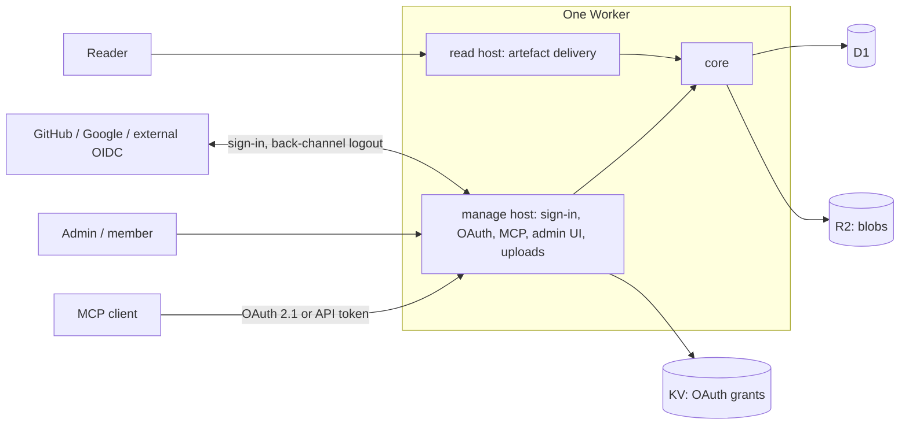

# unkill-forge — Specification (Forge v2)

Status: draft for owner approval · 2026-11-22 · Repository: `go-silex/unkill-forge` (public, MIT, fresh history).

This document is public-safe: it describes the product only. Instance data, hostnames and migrations from other systems live in private operator material, never in this repository.

## 1. Purpose

Forge lets a team publish HTML artefacts (one page or a small static folder) at stable URLs, decide who can read them, and create, read and edit them from AI agents through a remote MCP server.

Design target: one person can read the whole codebase in an afternoon and deploy it to their own Cloudflare account in under an hour.

## 2. Goals and non-goals

| # | Goal |
|---|---|
| G1 | Publish, update and read back artefacts from claude.ai, Claude Desktop, Claude Code, Codex, autonomous agents such as Hermes, or any MCP client, with no local plugin. |
| G2 | Three ways to read: members (private), anyone holding a revocable share link, everyone (public). |
| G3 | Sign-in through GitHub, Google, or an external identity manager over OIDC (an in-house identity provider, Cloudflare Access, Keycloak, Entra…). Deactivation at the identity manager reaches Forge. Instance roles; bot members for automation. |
| G4 | Forkable: Cloudflare only (Workers, D1, R2, KV); branding through configuration and assets, not code edits. |
| G5 | Small: a runtime budget around 5,000 lines of TypeScript, tracked, not a release gate; at most four docs besides README. |
| G6 | Safe defaults: new artefacts are private; untrusted HTML runs on its own origin; every authorization decision reads live state. |

Non-goals:

- Multi-tenant SaaS. One deployment serves one team.
- Access control per page inside an artefact; assets shared across artefacts.
- HTML or CSS rewriting; revision-pinned reads.
- Preview image generation; built-in URL shorteners.
- A local plugin, native binaries or a CLI. MCP is the programmatic interface (see §17 for a possible HTTP API).
- Browser upload in the admin UI.
- Trusted-proxy identity headers (`Cf-Access-Jwt-Assertion`, forward-auth): external managers connect over OIDC.
- Linking several sign-in identities to one member.
- Isolation between artefacts of the same instance (see §13).
- Importers for other systems.

## 3. Vocabulary

| Term | Meaning |
|---|---|
| **Instance** | One deployment: its two hostnames, members, artefacts and storage. |
| **Artefact** | A named folder of files served under `/a/<slug>/`. The unit of access. |
| **Slug** | The artefact's address name. |
| **Revision** | An immutable, numbered snapshot of an artefact's file list. Publishing creates the next number. |
| **File** | A path inside a revision, pointing to a blob, with size and content type. |
| **Blob** | Content-addressed bytes in R2, keyed by SHA-256, shared by every file with the same content. |
| **Visibility** | `private` (members) or `public` (everyone). |
| **Share link** | A secret URL `/s/<slug>/<key>/` that lets anyone read one artefact until the link is revoked. |
| **Identity provider** | A configured sign-in source: `github`, or an `oidc` provider (Google, an external identity manager). |
| **Identity** | One (provider, subject) pair that has signed in. It belongs to one member. |
| **Member** | A human (one identity) or a bot (created by an admin), with a role: `viewer`, `publisher` or `admin`. |
| **API token** | A bearer secret belonging to one member, used by bots and scripts on the MCP endpoint. |
| **Invite link** | A single-use URL that makes the person who signs in through it a member with a given role. |

## 4. Architecture



- **One Worker, two hostnames.** The read host serves untrusted artefact HTML; the manage host carries sessions, OAuth and administration. The Worker first matches the request against the two configured HTTPS origins and answers 404 to anything else, before any authentication, routing or asset lookup. `workers_dev` and preview URLs are disabled. No route exists on both hosts.
- **Core owns policy.** `src/core/` alone owns Forge's tables and R2, and alone decides access, roles and session validity. Adapters (delivery, MCP, admin UI, sign-in, OAuth glue) verify credentials, call core and render results; they make no authorization decision of their own.

| Concern | Choice | Why |
|---|---|---|
| HTTP | Hono | Small, Workers-native, JSX for server-rendered pages. |
| Sign-in | Forge login module on `oauth4webapi` + `jose` (panva) | One code path for every OIDC provider (Google included) plus a small GitHub adapter; Forge owns sessions, claim rules, silent revalidation and back-channel logout, which generic auth frameworks leave to the application. |
| MCP authorization | `@cloudflare/workers-oauth-provider` (KV) | Workers-native OAuth 2.1 server: PKCE, CIMD, optional DCR, and a token-resolution hook for API tokens. Gate 0 confirms it. |
| MCP protocol | `@modelcontextprotocol/sdk`, Web-standard Streamable HTTP, stateless, JSON responses | No sessions, no Durable Objects. |
| Validation | zod | One schema per tool and form. |
| Database | D1, plain SQL migrations (`wrangler d1 migrations`) | Readable by forkers; no ORM. |
| Tests | Vitest + `@cloudflare/vitest-pool-workers` (real D1/R2 in workerd) | Behaviour tests. |
| Tooling | npm + TypeScript | No Bun, Turborepo or monorepo. |

Repository layout:

```
src/
  index.ts        origin dispatch, cron entry
  core/           artefacts, revisions, blobs, access, shares, members, sessions, tokens, uploads, redirects, audit
  read/           delivery, login handoff
  manage/         ui/ (Hono JSX), mcp/ (tools), oauth/ (consent, provider glue), login/ (oidc, github, back-channel), upload.ts
  config.ts       parse and validate configuration once
migrations/
brand/            default logo, favicon, colours
test/
docs/             self-hosting.md, mcp.md, architecture.md, security.md
wrangler.jsonc    template without account identifiers
```

**Decision: standalone, not a kit product.** Starting from `unkillable-kit` would hand every fork a full monorepo (Bun/Turbo, 15 packages, multi-tenant schema, kit governance). Forge uses upstream libraries directly. It takes the kit's MCP OAuth decisions as reference (CIMD first, consent on a dedicated origin, Worker-issued tokens), not its code.

## 5. Data model

| Table | Columns (essentials) |
|---|---|
| `members` | `id` PK, `kind` ∈ human/bot, `name`, `email`, `role` ∈ viewer/publisher/admin, `status` ∈ active/removed, `created_at`, `created_by`, `removed_at` |
| `identities` | (`provider`, `subject`) PK, `member_id` UNIQUE, `email`, `email_verified`, `last_login_at` |
| `login_flows` | `state_hash` PK, `browser_hash`, `provider`, `nonce`, `code_verifier`, `return_path`, `invite_hash`, `expires_at` |
| `sessions` | `id_hash` PK, `member_id`, `provider`, `subject`, `sid`, `auth_time`, `created_at`, `validated_at`, `expires_at`, `revoked_at` |
| `identity_revocations` | `jti` PK, `provider`, `subject`, `sid` NULL, `received_at` |
| `invites` | `token_hash` PK, `role`, `created_by`, `expires_at`, `used_by`, `used_at` |
| `artefacts` | `id` PK, `slug` UNIQUE, `title`, `visibility` ∈ private/public, `current_revision`, `created_by`, `created_at`, `updated_at`, `deleted_at` |
| `revisions` | (`artefact_id`, `number`) PK, `created_by`, `created_at`, `message` |
| `files` | (`artefact_id`, `revision`, `path`) PK, `sha256`, `size`, `content_type` |
| `share_links` | `id` PK, `artefact_id`, `label`, `key_hash` UNIQUE, `key_sealed`, `created_by`, `created_at`, `revoked_at`, `last_used_at` |
| `api_tokens` | `id` PK, `member_id`, `name`, `prefix`, `token_hash` UNIQUE, `created_at`, `last_used_at`, `revoked_at` |
| `uploads` | `token_hash` PK, `member_id`, `slug`, `path`, `sha256`, `size`, `content_type`, `state` ∈ pending/stored/consumed, `expires_at` |
| `handoffs` | `code_hash` PK, `session_id_hash`, `state_hash`, `return_path`, `expires_at` |
| `redirects` | `from_prefix` PK, `to_prefix`, `created_at` |
| `audit_log` | `id`, `at`, `member_id`, `action`, `artefact_id`, `detail_json` |

Indexes:

- `artefacts(deleted_at, updated_at)`, `share_links(artefact_id)`, `files(sha256)`;
- `sessions(member_id)`, `sessions(provider, subject)`, `sessions(provider, sid)`, `identity_revocations(provider, subject)`;
- `api_tokens(member_id)`, `audit_log(artefact_id, at)`;
- `expires_at` on `login_flows`, `uploads`, `handoffs`.

Rules:

- Blobs live at `blobs/<sha256>` in R2, written with R2's SHA-256 check and never overwritten. A new revision reuses existing blobs for unchanged files: no byte copy.
- Slug: `^[a-z0-9](?:[a-z0-9-]{0,62}[a-z0-9])?$`. A slug is unavailable while a live artefact, a soft-deleted artefact or a redirect prefix uses it.
- Path: relative POSIX path, ≤ 512 characters, no empty, `.` or `..` segment, no segment starting with `.`, no backslash or control character.
- Retention: the last 20 revisions per artefact by default (configurable), so `files` stays bounded within D1's size limits.
- Defaults (configurable): 1,000 files per artefact; 2 MB of inline content per MCP call; 100 MB per uploaded file.

## 6. Access model

**Canonical reads** (`/a/…`), decided by core:

1. Artefact missing or deleted → not found.
2. `public` → allowed.
3. Viewer holds a valid session (§10) of an **active** member → allowed.
4. Otherwise → anonymous: login handoff; signed-in non-member: "pending access" page.

**Share-link reads** (`/s/…`) use one rule only: the key matches an unrevoked share link of that artefact, whatever its visibility. A revoked key returns 404 even on a public artefact.

| Action | viewer | publisher | admin |
|---|:-:|:-:|:-:|
| Read private artefacts | ✓ | ✓ | ✓ |
| Create, publish, edit, rename, delete, restore; visibility; share links | | ✓ | ✓ |
| Own API tokens | | ✓ | ✓ |
| Members, bots, invite links, redirects, purge; supply a share key at creation | | | ✓ |

- Publishers may change any artefact: a team trusts its publishers.
- Every request loads the member's live status and role from D1; tokens and cookies never carry a role. Removing a member ends read, UI and MCP access on their next request, OAuth refresh included.

## 7. Read host

Resolution order for a request:

1. `/a/<slug>` → 301 to `/a/<slug>/`.
2. `/a/<slug>/<path>` where `slug` is a live artefact → resolve `path`, then `path/index.html`, then `path.html` in the current revision; apply canonical access.
3. `/s/<slug>/<key>/<path>` where `slug` is a live artefact → same resolution under share-link access. Relative links stay under the share prefix, so no cookie is involved.
4. `/_forge/session` → end of the login handoff.
5. Otherwise, the longest matching `redirects.from_prefix` → 302 to the target with the remaining path. Redirects never shadow a live artefact.
6. `/` → the public artefact index when `PUBLIC_INDEX=true`, else the branded landing page.
7. Anything else → 404.

Unknown artefact, unauthorized share request and missing file all return the same 404.

Response headers:

- All responses: `X-Content-Type-Options: nosniff`; `Referrer-Policy: same-origin`.
- `X-Robots-Tag: noindex`, unless the artefact is public and indexing is enabled.
- Caching: `/s/` and non-public content send `Cache-Control: private, no-store`. Public content sends `no-cache` with the blob hash as `ETag`, so every request, including a `304`, goes through the access check.
- Range requests are served from R2.

**Login handoff.** Sessions live on the manage host; the read host keeps its own cookie, bound to that session.

1. Anonymous request for a private artefact: the read host sets a short-lived `__Host-forge-state` nonce cookie, then 302s to `https://<manage>/auth/handoff?return=<path>&state=<nonce>`.
2. The manage host requires a valid session (signing in if needed) of an active member. It validates `return` as a read-host path starting with `/a/` (decoded, normalised, no scheme, no `//`), stores a single-use code (60 s) with the session and the state hash, then 302s to `https://<read>/_forge/session?code=…&state=…`.
3. The read host checks that `state` matches its nonce cookie, consumes the code atomically (`DELETE … RETURNING`), sets `__Host-forge` (HttpOnly, Secure, SameSite=Lax), an HMAC-signed `{sessionIdHash, exp}`, clears the nonce, and redirects to the stored path.
4. Each private read checks that the bound manage session is still valid and its member active. Signing out, session revocation and identity revocation on the manage side end read access too.

## 8. Publishing semantics

- **Atomic commit.** `publish` builds revision *n+1* and commits it in one D1 batch: insert the `revisions` row, copy unchanged file rows with one `INSERT … SELECT`, insert new file rows, mark uploads consumed, move `current_revision`, append the audit row. The `revisions` primary key is the compare-and-set: if another publish already took *n+1*, the whole batch fails and nothing changes.
- With `expectedRevision`, a mismatch returns `conflict` and the current revision. Without it, `merge` publishes retry on the new head (at most three times) and `replace` publishes overwrite the head.
- `mode: "merge"` keeps unmentioned files; `mode: "replace"` makes the call the complete file list; `delete` removes listed paths.
- A new artefact starts private at revision 1. Content types come from the extension unless supplied. The result returns the entry URL: `/a/<slug>/` when `index.html` exists, otherwise the first HTML file in path order.
- **Restore** creates a new revision from a retained one.
- **Rename** moves the slug and creates redirects from `/a/<old>/` and `/s/<old>/` to the new prefixes; existing redirects that pointed at the old slug are retargeted, so chains never form. Share links keep working through the redirect.
- **Delete** is soft for 30 days (admins can restore); a daily cron then purges the D1 rows.
- **Blobs are append-only.** Nothing deletes them automatically: storage is cheap at team scale, and deleting while another publish reuses the same bytes would corrupt it. An admin **purge** hard-deletes an artefact, then deletes each blob no other file references, rechecked just before deletion. This is for content that must disappear, such as a leaked secret, and is documented as racing with a concurrent publish of identical bytes.
- The cron also expires login flows, sessions, uploads, handoffs, invites, old identity revocations and revisions beyond retention.
- A reader who loads a page during a publish may get assets from two revisions. Accepted.

## 9. MCP server

Endpoint `https://<manage>/mcp`: Streamable HTTP, stateless, JSON responses. Two credentials reach it.

**OAuth, for people working through an agent client.**

- OAuth 2.1 with PKCE (S256); the endpoint answers `401` with RFC 9728 resource metadata.
- Clients identify by Client ID Metadata Document (fetched with `global_fetch_strictly_public`), advertised together with `none` client authentication so Claude uses it. Dynamic Client Registration stays off unless Gate 0 shows that a required client cannot use CIMD.
- Redirect URIs match exactly, except loopback hosts, which match on any port.
- Authorization runs on the manage host: the person signs in (§10) and approves the consent page. Consent is always shown, with the verified client identity (the CIMD URL host, or "unverified client" otherwise) and the redirect host. Loopback-only clients get an explicit warning.
- Access tokens are bound to the `/mcp` resource and last one hour. Refresh tokens rotate and last 7 days, then the person signs in again.
- Every token exchange, refresh and MCP request rechecks that the member is active and that their identity has no revocation newer than the grant (§10).

**API tokens, for bots and autonomous agents** (Hermes, CI, scheduled jobs).

- Sent as `Authorization: Bearer fgt_…`; resolved through the provider's external-token hook.
- The callback hashes the token and requires an unrevoked token of an active member. Tokens work on `/mcp` only.
- A bot is its own bot member with a publisher token, never an admin's token.

**Tools.**

| Tool | Input | Result |
|---|---|---|
| `whoami` | — | member, role, read and manage URLs |
| `list_artefacts` | `query?`, `cursor?` | slug, title, visibility, revision, updated |
| `get_artefact` | `slug`, `cursor?` | metadata, current revision, a page of files (path, size, type), URL, share links without keys |
| `read_file` | `slug`, `path`, `revision?`, `offset?`, `limit?` | revision read, total length, a text slice (default 40,000, max 100,000 characters); binary files return metadata only |
| `publish` | `slug`, `title?`, `files[]` (`{path, content, encoding?}` or `{path, uploadId}`), `mode`, `delete?`, `expectedRevision?`, `message?` | entry URL, revision |
| `edit_file` | `slug`, `path`, `oldText`, `newText`, `expectedRevision` (required), `replaceAll?` | new revision; fails unless exactly one match (or `replaceAll`) |
| `create_uploads` | `slug`, `files[]` (`path`, `size`, `sha256`, `contentType?`) | per file: `uploadId` and a single-use `PUT` URL valid 15 min, or "already stored" when the blob exists |
| `set_visibility` | `slug`, `visibility` | — |
| `create_share_link` | `slug`, `label?`, `key?` (admin only) | share URL, in full |
| `list_share_links` | `slug` | id, label, created, last used |
| `get_share_link` | `id` | share URL, to copy it again |
| `revoke_share_link` | `id` | — |
| `list_revisions` | `slug` | number, author, date, message |
| `restore_revision` | `slug`, `revision` | new revision |
| `rename_artefact` | `slug`, `newSlug` | new URL |
| `delete_artefact` | `slug` | — |
| `set_redirects` | `add[]`, `remove[]` (admin only) | — |

- Tool descriptions are written for agents: when to use the tool, what it changes, what to tell the user.
- Results are compact JSON text. Errors use stable codes: `not_found`, `forbidden`, `conflict`, `invalid_input`, `too_large`.
- Members, bots and invites are managed in the admin UI, not over MCP.

**Uploads.** `create_uploads` returns capability URLs on the manage host, `PUT /upload/<token>`. They serve shells that cannot hold the OAuth token.

- The token is 256 random bits, stored hashed, bound to member, slug, path, size and SHA-256, valid 15 minutes.
- The first `PUT` atomically moves the upload from `pending` to receiving; the Worker streams the body to R2 with the declared SHA-256 and marks it `stored`. Any other `PUT` is refused.
- `publish` accepts only `stored` uploads of the same member, slug and path, and marks them `consumed` in its commit batch.
- A local folder is published in three steps: `create_uploads` → a shell loop of `curl -T` → `publish`. `docs/mcp.md` gives the recipe.

## 10. Sign-in and accounts

**Providers** are listed in configuration; at least one is required.

| Type | Use | Mechanics |
|---|---|---|
| `github` | GitHub accounts | OAuth 2.0 code flow with PKCE; identity from `/user`; email from `/user/emails`, primary and verified only. |
| `oidc` | Google, or an external identity manager (an in-house provider, Cloudflare Access SaaS OIDC, Keycloak, Entra…) | Discovery, Authorization Code + PKCE S256, confidential client, ID token validated against JWKS (issuer, audience, dates, nonce), then UserInfo with the same `sub`. |

Each `oidc` provider declares:

- `requireClaims`: claims that must hold, in both ID token and UserInfo, or sign-in is refused. For example `{"email_verified": true, "active_member": true}`, where `active_member` is whatever claim the identity manager uses to say a person belongs to the team.
- `autoJoinRole`: the role granted at first sign-in when the claims hold. Omit it to require an invite.
- For Google: `hostedDomains`, a list of accepted `hd` values (Workspace domains).
- `sessionMaxHours` (default 8) and `revalidateAfterMinutes` (default 15, `0` disables).
- `backchannelLogout` (default on when the provider advertises it).

**Login flow.**

- `/login/<provider>` stores a single-use flow (5 minutes) bound to a browser cookie, with state, nonce and PKCE verifier.
- The callback consumes the flow atomically (`DELETE … RETURNING`), validates as above, then admits (below) and creates a session.
- The session cookie `__Host-forge-session` (HttpOnly, Secure, SameSite=Lax) is opaque; D1 stores only its hash. It records provider, subject, `sid` and `auth_time`.

**Admission** at first sign-in, first match wins:

1. **Bootstrap**: while the instance has no active admin, a verified email listed in `ADMIN_EMAILS` becomes admin. Once an admin exists, the list is ignored.
2. **Invite link** opened before signing in: its role. Single use, 7 days.
3. **Provider auto-join**: `autoJoinRole` of the provider, once its claims (and `hostedDomains` for Google) hold.
4. Otherwise: pending, until an admin adds the person.

A removed member keeps `status = removed` and is never admitted again automatically; only an admin can reinstate them. Each identity is its own member: a matching email never hands an account to another provider's identity. Bots are created by admins in the UI; they have no sign-in, only API tokens.

**Keeping sessions true to the identity manager.**

- **Hard cap.** A session never outlives `sessionMaxHours`.
- **Silent revalidation** (OIDC). Once `revalidateAfterMinutes` have passed, the next top-level HTML navigation goes back to the provider with `prompt=none`. Success refreshes `validated_at` without extending the cap and rechecks the claims. `login_required` or a failed claim ends the session. API-style requests from the UI get `401` instead of a redirect. If the provider is unreachable, the request gets `503`, never access.
- **Back-channel logout** (OIDC). `POST /login/<provider>/backchannel-logout` accepts a signed `logout_token`. It must pass issuer, audience and dates, carry the back-channel event, have no `nonce` and an unseen `jti`. The token is recorded in `identity_revocations`:
  - with a `sid`, it ends that session;
  - with only a `sub` (for example a deactivated account), it ends every session of that identity and every OAuth grant issued before it.
- **Local sign-out** (`POST /logout`, origin-checked) ends the current Forge session only. The identity manager's session and other devices stay.
- GitHub has no revalidation or logout channel: its sessions rely on the cap and on Forge membership.

## 11. Admin UI (manage host)

Server-rendered with Hono JSX: no SPA, a few lines of JavaScript for copy buttons. English and French.

Pages:

- sign-in (one button per provider), pending access;
- artefacts (search, visibility filter);
- artefact detail: open, files, revisions with restore, visibility, share links create/copy/revoke, rename, delete;
- members (humans with their provider, bots, roles, removal, reinstatement), invite links;
- API tokens, redirects;
- "Connect an agent": MCP URL and per-client steps;
- OAuth consent.

## 12. Configuration, branding, deployment

| Kind | Names |
|---|---|
| Vars | `FORGE_NAME`, `READ_ORIGIN`, `MANAGE_ORIGIN`, `LOCALE`, `PUBLIC_INDEX`, `ADMIN_EMAILS`, `AUTH_PROVIDERS` (JSON list of provider settings, §10), limits |
| Secrets | `FORGE_SEAL_KEY`, `FORGE_COOKIE_KEY`, one `AUTH_<ID>_CLIENT_SECRET` per provider |
| Bindings | `DB` (D1), `BLOBS` (R2), `OAUTH_KV` (KV), optional rate-limit binding |

- Configuration is parsed once. Any invalid value makes every request answer 503 and logs the list of errors.
- **Branding** is data: name, logo, favicon, colours and landing text, from configuration and `brand/`. Page structure, sign-in and consent markup belong to Forge, so forks merge upstream without touching security-relevant templates.

Deployment needs a Cloudflare zone for the two hostnames, plus at least one identity provider. Order:

1. Register Forge as a client of each provider. The callback is `https://<manage>/login/<id>/callback`; for OIDC managers that support it, the back-channel logout URI is `https://<manage>/login/<id>/backchannel-logout`.
2. Either click **Deploy to Cloudflare** (it forks the repository, provisions D1, R2 and KV from `wrangler.jsonc`, asks for secrets and runs the migration command), or use the CLI: clone → `npm ci` → set origins and providers in `wrangler.jsonc` → `npx wrangler secret put …` → `npm run deploy` (provisions missing resources, applies migrations, deploys).
3. Attach the two custom domains.
4. Sign in with an `ADMIN_EMAILS` address.

Operators who keep their configuration private run `npm run deploy -- --config <path>` with a file outside the repository. Workers Free is enough for light use; Workers Paid is recommended for large publishes (CPU time).

## 13. Security

- **Origins.** Dispatch on the configured origins before anything else; host-only cookies; no route shared between hosts.
- **Cross-origin writes.** The two hosts are same-site, so SameSite cookies do not stop a read-origin page from sending requests to the manage host. Every state-changing request authenticated by cookie (UI forms, consent, logout) requires `Origin` to equal the manage origin exactly. MCP rejects any browser `Origin` other than an allowlisted client origin.
- **Manage host.** Strict CSP, `frame-ancestors 'none'`. Uploaded content is never served from it.
- **Sign-in.** Flow bound to the browser and consumed once; PKCE S256; nonce; strict issuer and audience checks; no implicit or hybrid flows; refusal on any missing required claim; a provider or D1 failure denies access.
- **Share keys.** 128 random bits, base64url. Imported keys of 16–128 URL-safe characters are accepted. Stored as SHA-256 plus an AES-GCM sealed copy (`FORGE_SEAL_KEY`) so publishers can copy the link again. Never written to application logs.
- **API tokens.** 256 random bits, stored as SHA-256, shown once, revocable, `last_used_at` tracked.
- **Audit.** Every mutation writes `audit_log`. Optional rate limiting on sign-in, OAuth, handoff and share paths.

Known limits, stated in `docs/security.md`:

- Artefact JavaScript runs on the read origin with the viewer's cookie and can fetch any artefact that viewer can read. Publishers are trusted; never publish untrusted third-party HTML. Per-artefact origins are the upgrade path.
- A share key travels in the URL. `Referrer-Policy` keeps it from third parties by default, but artefact HTML can override the policy, artefact JavaScript can read its own URL, and Cloudflare request logs may record paths. Anyone holding a link can forward it until revocation.
- Back-channel logout is best effort: a lost notification leaves a session alive until revalidation or the cap, and an MCP grant until its refresh lifetime ends.
- Bytes already downloaded cannot be recalled.

## 14. Repository and process

- Public, MIT, fresh history. Contents: `src`, `migrations`, `brand`, `test`, four docs, README, CHANGELOG (user-facing, one line per change), SECURITY, CONTRIBUTING.
- Never in this repository: instance configuration, account identifiers, operational logs, migrations from other systems.
- CI on pull requests: typecheck, lint, tests. Release: tag `vX.Y.Z` plus changelog. Dependabot.
- Behaviour tests on real D1/R2 cover:
  - the access matrix and share-link rule;
  - publish CAS, edit and conflict;
  - upload states;
  - origin dispatch and cross-origin write refusal;
  - login flow replay, required claims, revalidation outcomes, back-channel logout by `sid` and by `sub`;
  - handoff binding and replay;
  - admission, removal and reinstatement;
  - OAuth consent and API-token resolution.

## 15. Delivery

| Step | Content | Exit |
|---|---|---|
| **Gate 0** | Skeleton on a test zone, configured as production (CIMD advertised, DCR off): GitHub, Google and one external OIDC manager with a required claim; sessions; OAuth server; consent; `whoami`. | claude.ai custom connector, Claude Desktop, Claude Code, Codex, OMP and Hermes (API token) connect. Refresh works. A removed member is refused at refresh and call. A deactivation at the external manager ends the session and the MCP grant. DCR need decided per client; OAuth library confirmed. |
| **Phase 1** | Data model, publish/edit/read, uploads, delivery, access, share links, handoff, admin UI, members, bots, invites, API tokens, cron, docs, deploy button. | Acceptance criteria below. |
| **Phase 2** | First production instances, from private operator material. | Outside this repository. |

## 16. Acceptance criteria

| # | Criterion |
|---|---|
| C1 | From claude.ai, a member signed in with GitHub publishes a single HTML file in one tool call and gets its URL; the artefact is private. |
| C2 | The same member reads the file, changes one sentence with `edit_file` at the read revision, and the URL serves the change. An `edit_file` with a stale revision fails with `conflict`; two concurrent publishes yield one winner and one `conflict`, with no partial revision. |
| C3 | An anonymous browser opens a share link, including relative CSS, JS and images. After `revoke_share_link`, the next request returns 404, even if the artefact is public. |
| C4 | Anonymous: a public artefact is readable; a private one starts the login handoff. Signed-in non-member: pending page. Viewer: reads private, cannot publish. |
| C5 | A member removed by an admin loses read, UI, MCP and refresh access on the next request, and is not re-admitted by bootstrap or auto-join. |
| C6 | Sign-in works with GitHub, Google (with `hostedDomains`) and an external OIDC manager. A person lacking a required claim is refused. Deactivating the person at the manager ends their Forge sessions and MCP grant, through back-channel logout or at the next revalidation. |
| C7 | Claude Code, Codex, OMP and Hermes use the same `/mcp`; a bot member publishes with its publisher token and cannot call admin tools. |
| C8 | A newcomer follows the README on a fresh Cloudflare account with a zone, and reaches a working instance whose first admin comes from `ADMIN_EMAILS`. |
| C9 | A 50 MB binary goes through `create_uploads` and `curl -T`, is published, and serves with Range support; replaying the upload URL fails. |
| C10 | A script on the read origin cannot change anything on the manage host; a handoff code or login flow redeemed in another browser does not create a session. |
| C11 | The repository holds no instance data or migration tooling; the runtime line count is reported in the README. |

## 17. Open questions

1. **HTTP API for autonomous agents.** Proposal: none in v2.0. Hermes already speaks remote MCP over Streamable HTTP with configured headers, so an API token on `/mcp` covers it; a REST API would duplicate every tool. Revisit if an agent framework without MCP must publish.
2. Default revision retention (20 proposed).
3. Public index on the read host: on or off by default.
